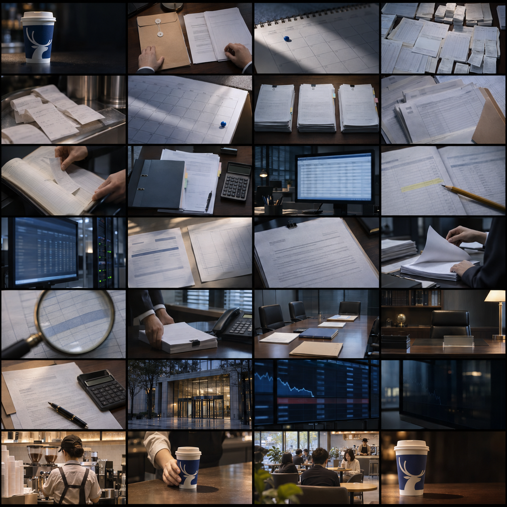

# Luckin Coffee — Part 2 storyboard | 00:30–01:00

**28 storyboard frames · 24 fps · 1280×720 · 720 total frames**

Read the 4-column by 7-row board left-to-right, then top-to-bottom. Each cell is a distinct photorealistic concept shot; the frame index and exact timing are in the sections below. The pictures are AI-generated visual references, not real Luckin footage, actual people, or source records. Use the source checklist below when replacing concept references with final assets.

## Story purpose

Continue from the previous 30-second segment’s question about how the company outlived its scandal. This section establishes what the SEC alleged, how the complaint described the mechanisms and concealment, how the matter surfaced, the company response and settlement, and the public-market consequence. It returns to coffee only to ask what happened to the operating business. It does not claim a recovery result.

## Voiceover draft

> To understand what survived, first understand the SEC’s allegations. The SEC alleged that Luckin fabricated more than RMB 2.12 billion in retail sales from April 2019 through January 2020. Its complaint described three purchasing schemes involving related parties. It also said employees inflated expenses by more than $190 million, created a fake operations database, and altered accounting and bank records. The matter surfaced during the annual external audit. Luckin reported it and began an internal investigation. It later agreed to a $180 million SEC penalty without admitting or denying the charges. Nasdaq delisted the shares in July 2020. The ticker vanished. What happened to the coffee business?

Draft pace: approximately 160–170 words per minute. Attribution is deliberately explicit. The settlement line must retain “without admitting or denying the charges.”

## Visual grammar

- **Evidence palette:** charcoal, ink blue, cool cyan for source marks; keep red out of routine evidence beats.
- **Warmth has narrative meaning:** amber and cafe light enter only after the delisting sequence, signaling a shift from ticker to operating business.
- **One compositional idea per state:** figures, time rails, record planes, audit card, settlement card, listing status, then cup. Avoid repeated collages.
- **Typography carries verifiable facts:** large figures stay paired with their currency, source attribution, and claim label. No fake price chart or unsupported metric.
- **Depth is motivated:** background desk/cafe plane, one or two schematic document layers, then annotation. Camera stays still during legal and numerical holds.
- **Transitions connect story logic:** sales tiles feed into records; records flatten into the audit; ticker line match-cuts to the cup. No shattering, flames, villain silhouettes, or fake source paperwork.
- **Readability before spectacle:** settle each layer before narration’s key noun; keep frame annotations out of the final video unless deliberately retained as editorial labels.

## Image and layer plan

The contact sheet now shows the planned shot content. The animation notes are secondary. For each group, the image layer and future cutout/source need are:

| Frames | Image content to build the shot around | Future production asset or source |
|---|---|---|
| 01–06 | Blue-sleeved cup, complaint folder, calendar, receipt and ledger surfaces | Reuse the approved cup reference; source the actual SEC complaint page; create clean generic paper props only for illustrative beats |
| 07–14 | Three paper bundles, linked invoice packets, sales slips, expense paperwork, database monitor, misaligned records, bank-style statement | Create separate paper/monitor cutouts and a dark desk background; replace any evidence-like page with an attributed source image |
| 15–20 | Complaint page, auditor hands, magnifier over generic row, disclosure packet, review table, cleared office | Use the actual SEC complaint/release for document close-ups; generate or license hands, desk, and office plates; no invented executive portraits |
| 21–24 | Settlement pages, civic office exterior, delisting screen, dark monitor reflection | Source settlement language and delisting status; build the listing screen as an editable graphic, with no invented prices |
| 25–28 | Warm operating café, barista and cup, customers, final cup close-up | Source licensed Luckin store/operations imagery or create approved illustrative plates; prepare cup and hand as separate cutouts for compositing |

The contact sheet is **photographic storyboard concept art**. It is there to show the actual subjects, backgrounds, and foreground objects each frame needs. It is not a claim that the pictured people, papers, office, or café are historical Luckin material. The final sourced or approved cutouts/backgrounds are still to be created individually.

## Frame-by-frame board

### Frame 01 · 30.00–30.75s · The surviving question

**Picture:** What survived?

**Voiceover:** To understand what survived,

**Animation plan:**
- **Enter:** Warm cup rim dissolves into a cold evidence-desk edge; no new prop appears before the cut.
- **Hold:** Hold the question for a breath, then pull focus to the desk grain.
- **Exit:** Camera eases back 2% and settles; question opacity falls only after desk texture resolves.
- **Transition:** Match-cut from the previous segment’s cup; hold the open loop.

**Future assets:** Existing cafe/evidence-desk plates; title only.

**Accuracy gate:** No factual claim; transition is editorial.

### Frame 02 · 30.75–31.67s · The allegation frame

**Picture:** What the SEC alleged

**Voiceover:** first understand what the SEC alleged.

**Animation plan:**
- **Enter:** A thin cyan rule draws left to right; a plain label resolves beneath it.
- **Hold:** Card holds without parallax so the attribution is readable.
- **Exit:** Card slides down a few pixels and fades; background remains fixed.
- **Transition:** Cut from the question into a source-led title.

**Future assets:** Editorial SEC attribution card; later replace with a sourced filing crop if desired.

**Accuracy gate:** Label the card as an editorial summary; use the official SEC complaint for exact wording.

### Frame 03 · 31.67–32.58s · Time window begins

**Picture:** April 2019

**Voiceover:** From April 2019

**Animation plan:**
- **Enter:** Timeline rule grows from a single point; month label enters on a separate type layer.
- **Hold:** Small, deliberate pulse at the date marker; no decorative ticking.
- **Exit:** Marker glow reduces to a steady pin as the next date appears.
- **Transition:** A measured timeline reveal starts the factual chronology.

**Future assets:** Editable date typography and a timeline line; no new photographic asset.

**Accuracy gate:** Date range is stated in the SEC complaint.

### Frame 04 · 32.58–33.58s · Sales figure resolves

**Picture:** RMB 2.12 billion

**Voiceover:** The SEC alleged that Luckin fabricated more than 2.12 billion renminbi in retail sales.

**Animation plan:**
- **Enter:** Unit appears first, then digits resolve in grouped blocks; the attribution stays on screen.
- **Hold:** Brief 12-frame hold after full amount resolves; no flashing or odometer effect.
- **Exit:** Digits settle downward into a ledger-like baseline.
- **Transition:** Amount resolves after the sales window is established.

**Future assets:** Large editable amount, unit, SEC-allegation caption.

**Accuracy gate:** SEC complaint alleges more than RMB 2.12 billion in fabricated retail sales.

### Frame 05 · 33.58–34.67s · Sales label clarifies

**Picture:** Fabricated retail sales

**Voiceover:** in fabricated retail sales

**Animation plan:**
- **Enter:** Tiles enter as a controlled 3×2 stack; no shop names, order IDs, or fake receipt details.
- **Hold:** One clean read hold; retain the word “alleged” in the source context.
- **Exit:** Tile stack compresses into a line that carries into the time window.
- **Transition:** Graphics are schematic; no invented primary evidence.

**Future assets:** Abstract transaction tiles; on-screen illustrative label.

**Accuracy gate:** The SEC complaint is the source; this stack is not a reconstruction of actual entries.

### Frame 06 · 34.67–35.83s · Time window closes

**Picture:** January 2020

**Voiceover:** from April 2019 through January 2020.

**Animation plan:**
- **Enter:** Endpoint marker draws in; the bracket closes gently around the period.
- **Hold:** Date labels stay static and legible.
- **Exit:** Bracket dims as the composition shifts to mechanism.
- **Transition:** Complete the SEC complaint’s alleged date range.

**Future assets:** Editable date labels and timeline rule.

**Accuracy gate:** Use the complaint’s period wording; do not imply day-level precision.

### Frame 07 · 35.83–36.92s · Three mechanisms

**Picture:** Three purchasing schemes

**Voiceover:** The SEC described three purchasing schemes

**Animation plan:**
- **Enter:** Three lanes assemble sequentially with consistent spacing.
- **Hold:** Each lane holds briefly; no made-up company names or transaction amounts.
- **Exit:** The lanes converge toward a single neutral ledger panel.
- **Transition:** A three-part visual explains the complaint’s structure.

**Future assets:** Three abstract paths, editable vector lines and labels.

**Accuracy gate:** The SEC complaint describes three separate purchasing schemes.

### Frame 08 · 36.92–37.92s · Related-party links

**Picture:** Related parties

**Voiceover:** involving related parties,

**Animation plan:**
- **Enter:** Connectors draw outward-to-inward; the diagram labels itself “SEC complaint summary.”
- **Hold:** One restrained connector pulse travels once, then stops.
- **Exit:** External nodes fade first; the receiving ledger remains.
- **Transition:** Show relationship and direction, not a fabricated corporate org chart.

**Future assets:** Generic node-and-link diagram, editable labels.

**Accuracy gate:** Exact scheme details must be sourced to the complaint; avoid invented entities.

### Frame 09 · 37.92–38.92s · Transactions enter records

**Picture:** Sales entered into records

**Voiceover:** and sales were entered into company records.

**Animation plan:**
- **Enter:** Tiles move on one straight path into the records plane; no floating piles.
- **Hold:** Camera stays orthographic for easy reading.
- **Exit:** The records plane turns slightly edge-on, motivating the next concealment layer.
- **Transition:** Tiles land inside the records plane, then the plane turns edge-on.

**Future assets:** Abstract ledger plane; generic lines only.

**Accuracy gate:** Do not show fabricated order IDs, dates, receipts, or original records.

### Frame 10 · 38.92–39.92s · Concealment claim

**Picture:** More than $190 million

**Voiceover:** The SEC also said employees inflated expenses by more than 190 million dollars.

**Animation plan:**
- **Enter:** Amount rises a short distance and locks; no equation is shown.
- **Hold:** Hold the attribution and unit together for readability.
- **Exit:** Second panel slides back to reveal the accounting surface beneath.
- **Transition:** Separate the sales allegation from expense allegation.

**Future assets:** Editable amount card; no invoices or named vendors.

**Accuracy gate:** SEC press release reports complaint allegation of more than $190 million in overstated expenses.

### Frame 11 · 39.92–40.92s · Expense layer

**Picture:** Qualitative expense columns build behind the ledger; the scale is explicitly marked illustrative and not to scale.

**Voiceover:** The SEC also said employees inflated expenses by more than 190 million dollars.

**Animation plan:**
- **Enter:** Three muted columns rise behind the sales ledger at unequal qualitative heights.
- **Hold:** No numeric scale, axis, or count-up; the amount stays attributed to the SEC complaint.
- **Exit:** Columns dim as altered record planes slide forward.
- **Transition:** Layer depth shifts from the expense chart to the accounting-record illustration.

**Future assets:** Abstract non-data columns; editable label.

**Accuracy gate:** Do not infer a mathematical offset between fabricated sales and expenses.

### Frame 12 · 40.92–42.00s · Records altered

**Picture:** One generic accounting row slips out of alignment under a separate annotation layer.

**Voiceover:** and altered records to conceal the sales.

**Animation plan:**
- **Enter:** Overlay drifts 8px laterally; a non-flashing outline marks the changed region.
- **Hold:** The base record stays fixed while only the overlay moves.
- **Exit:** Outline closes, then the record plane rotates toward the audit beat.
- **Transition:** Layered planes make alteration legible without inventing document content.

**Future assets:** Generic record surface, separate overlay, annotation line.

**Accuracy gate:** SEC complaint alleges altered accounting and bank records; show no fake excerpts.

### Frame 13 · 42.00–43.08s · Fake operations database

**Picture:** Operations database

**Voiceover:** It said employees created a fake operations database.

**Animation plan:**
- **Enter:** A blank grid panel assembles behind the record layer; no interface text or data rows are invented.
- **Hold:** Hold the label and attribution together; keep the panel visibly schematic.
- **Exit:** Grid lines drift out of alignment, then freeze.
- **Transition:** Expose concealment as another alleged mechanism without reconstructing an internal system.

**Future assets:** Generic database grid and an attribution label.

**Accuracy gate:** SEC press release describes a fake operations database; do not imply this is the actual system.

### Frame 14 · 43.08–44.25s · Bank record alteration

**Picture:** Two generic paper planes, accounting and bank records, offset from each other without invented figures.

**Voiceover:** The complaint also alleged altered accounting and bank records.

**Animation plan:**
- **Enter:** Two translucent record sheets enter from opposite sides and settle at different depths.
- **Hold:** Keep each plane legible and distinct; no numeric reconciliation.
- **Exit:** Both planes flatten into one page that motivates the accuracy note.
- **Transition:** Show the allegation at a structural level, without fake record contents.

**Future assets:** Two abstract paper planes; no text except the labels.

**Accuracy gate:** SEC complaint alleges altered accounting and bank records.

### Frame 15 · 44.25–45.33s · Allegation boundary

**Picture:** Allegations, not a filing facsimile

**Voiceover:** These are allegations in the SEC complaint,

**Animation plan:**
- **Enter:** Source label draws in; “ILLUSTRATIVE DIAGRAM” remains visible.
- **Hold:** Static hold long enough for clear legal attribution.
- **Exit:** Source label carries into the audit timeline.
- **Transition:** A brief accuracy pause protects the viewer from reading props as evidence.

**Future assets:** Typography only over schematic records.

**Accuracy gate:** SEC press release says the complaint alleges; settlement was without admitting or denying.

### Frame 16 · 45.33–46.42s · Audit begins

**Picture:** Annual external audit

**Voiceover:** The matter surfaced during Luckin’s annual external audit.

**Animation plan:**
- **Enter:** Folder enters by 140px and stops with a soft ease; paper texture remains generic.
- **Hold:** Camera locks; source label remains on screen.
- **Exit:** A narrow light pass tracks along the folder edge into the review cue.
- **Transition:** A physical paper entrance motivates the discovery beat.

**Future assets:** Generic folder plate/cutout; no fabricated audit report.

**Accuracy gate:** SEC says misconduct was discovered in the course of annual external audit.

### Frame 17 · 46.42–47.50s · Review cue

**Picture:** Audit flags a discrepancy

**Voiceover:** (visual beat: discrepancy found)

**Animation plan:**
- **Enter:** A simple outline traces once around an unlabeled region; use no siren red.
- **Hold:** Two-second equivalent editorial hold in the final edit; keep the motion restrained.
- **Exit:** Marker lifts off; the record stays in frame for disclosure.
- **Transition:** The source establishes discovery during audit, not specific audit tests.

**Future assets:** Highlight outline and generic ledger only.

**Accuracy gate:** Do not imply a particular audit procedure absent sourcing.

### Frame 18 · 47.50–48.58s · Disclosure

**Picture:** Matter reported

**Voiceover:** Luckin reported the matter,

**Animation plan:**
- **Enter:** Card appears in two stages: “reported” then “SEC”; no fabricated press-release screenshot.
- **Hold:** Hold a beat on the act of disclosure, not a dramatic alarm.
- **Exit:** Card folds down into the internal-review plane.
- **Transition:** Source-led transition from discovery to response.

**Future assets:** Editorial disclosure card; source text can be replaced with official filing later.

**Accuracy gate:** SEC says Luckin reported the matter to SEC staff and cooperated.

### Frame 19 · 48.58–49.67s · Internal investigation

**Picture:** Company investigation

**Voiceover:** and began an internal investigation.

**Animation plan:**
- **Enter:** Nodes appear one at a time around the central file; center remains readable.
- **Hold:** The ring completes, then pauses; no investigator silhouettes.
- **Exit:** Nodes reduce to two endpoints that carry the consequence forward.
- **Transition:** Abstract process graphic signals an internal review.

**Future assets:** Generic node ring, central file card.

**Accuracy gate:** SEC states that Luckin initiated an internal investigation.

### Frame 20 · 49.67–50.83s · Personnel consequences

**Picture:** Personnel removed

**Voiceover:** The SEC said certain personnel were terminated.

**Animation plan:**
- **Enter:** Role cards slide down and disappear; no faces and no name cards.
- **Hold:** The exact scope remains the phrase “certain personnel.”
- **Exit:** Cards clear the stage before the settlement amount.
- **Transition:** Keep consequences specific to source wording.

**Future assets:** Typography cards only.

**Accuracy gate:** SEC press release says Luckin terminated certain personnel.

### Frame 21 · 50.83–52.08s · Settlement terms

**Picture:** $180 million SEC penalty

**Voiceover:** Luckin later agreed to a 180 million dollar SEC penalty,

**Animation plan:**
- **Enter:** Amount and agency appear together; disclaimer is a distinct, legible layer.
- **Hold:** Hold amount and legal qualification together, not sequentially.
- **Exit:** Card eases down and narrows into a ticker strip.
- **Transition:** Avoid presenting settlement as a criminal conviction.

**Future assets:** Editorial settlement card; no reproduced legal document.

**Accuracy gate:** SEC press release dated December 16, 2020; settlement without admitting or denying.

### Frame 22 · 52.08–53.25s · Settlement qualification

**Picture:** Without admitting or denying

**Voiceover:** without admitting or denying the charges.

**Animation plan:**
- **Enter:** Text reveals as one complete phrase; no word-by-word suspense.
- **Hold:** At least 24 frames of clean hold at 24 fps.
- **Exit:** Source note persists as the market card enters.
- **Transition:** A pacing breath that prevents a misleading simplification.

**Future assets:** Editable legal qualifier and source note.

**Accuracy gate:** Use SEC’s precise formulation; do not paraphrase as guilt admission.

### Frame 23 · 53.25–54.33s · Market consequence

**Picture:** Nasdaq delisting

**Voiceover:** Nasdaq delisted the shares in July 2020.

**Animation plan:**
- **Enter:** Listing tag slides away; ticker typography remains momentarily.
- **Hold:** One directional move, then a quiet hold.
- **Exit:** Ticker compresses to a single line that fades at the next cut.
- **Transition:** Show delisting as a status change, not a market chart.

**Future assets:** Editable ticker/status card; no numerical price series.

**Accuracy gate:** SEC says shares traded until July 13, 2020; date can be sourced in the final graphics.

### Frame 24 · 54.33–55.42s · Ticker disappears

**Picture:** Public-market identity ends

**Voiceover:** The ticker vanished.

**Animation plan:**
- **Enter:** Typography reduces in opacity and scale; do not shatter or burn it.
- **Hold:** A half-second silent visual pause gives the transition room.
- **Exit:** Black lifts into cafe warmth at the edge of frame.
- **Transition:** End the public-market consequence without claiming the company ceased to exist.

**Future assets:** Typography only; existing cafe plate for the next transition.

**Accuracy gate:** Distinguish delisting from business closure.

### Frame 25 · 55.42–56.50s · Return to coffee

**Picture:** The warm cafe counter returns; the upper-left stays empty where the ticker had been.

**Voiceover:** (visual beat: the operating business remains the subject)

**Animation plan:**
- **Enter:** Warm practical light rises behind the counter; the cup enters last, after the background settles.
- **Hold:** Hold on an ordinary, operating cafe environment; no triumphant comeback imagery.
- **Exit:** A thin ticker line is carried across the cup rim to motivate the match cut.
- **Transition:** A tonal pivot from capital markets to physical operations.

**Future assets:** Existing cafe plate and cup cutout; no new production asset yet.

**Accuracy gate:** Do not imply scale, store count, or post-scandal performance without sourcing.

### Frame 26 · 56.50–57.58s · Ticker to cup match

**Picture:** A faint market ticker line aligns with the coffee cup rim, changing from flat public-market graphic to physical object.

**Voiceover:** (no new narration)

**Animation plan:**
- **Enter:** The ticker line travels horizontally and aligns precisely with the cup rim.
- **Hold:** The cup remains fixed; the graphic line and rim share one level.
- **Exit:** The ticker line dissolves as the camera begins a shallow push toward the cup.
- **Transition:** Ten-frame cross dissolve at the aligned rim; keep the cup silhouette stable.

**Future assets:** Existing cup cutout and cafe plate; later replace with approved product asset.

**Accuracy gate:** Symbolic match cut, not a claim about company recovery.

### Frame 27 · 57.58–58.75s · Business question

**Picture:** Cup holds on the right; left side opens for the question, “What happened to the coffee business?”

**Voiceover:** What happened to the coffee business?

**Animation plan:**
- **Enter:** Question enters from lower left only after the cup has locked into place.
- **Hold:** Keep the question fully readable; fade the old ticker into the background.
- **Exit:** A slow 2% push carries toward the next segment.
- **Transition:** Make the operational question distinct from shareholder recovery.

**Future assets:** Editable question type, cup, cafe background.

**Accuracy gate:** Next segment requires sourced evidence on operations after delisting.

### Frame 28 · 58.75–60.00s · Next chapter bridge

**Picture:** A quiet chapter bridge: “The business after delisting” appears beside the cup, with the answer deliberately withheld.

**Voiceover:** The next segment answers that question from sourced operating evidence.

**Animation plan:**
- **Enter:** Small “NEXT” chapter label appears first, then the subject line follows after a short beat.
- **Hold:** End with a 24-frame readable hold and gentle practical-light movement only.
- **Exit:** Fade to black during the final 8 frames; leave a clean cut point for the next segment.
- **Transition:** End with an editorial question, not a resolved comeback claim.

**Future assets:** Chapter title and one coffee/cafe anchor; later assets to be requested individually.

**Accuracy gate:** Build the next segment from sourced post-scandal operations and financial records.

## Factual sources and limits

- [SEC complaint against Luckin Coffee, Inc.](https://www.sec.gov/files/litigation/complaints/2020/comp-pr2020-319.pdf)
- [SEC press release, December 16, 2020](https://www.sec.gov/newsroom/press-releases/2020-319)

The board treats the SEC complaint’s mechanics as allegations. The closing “coffee business” question is an open loop; the following segment needs separately sourced operating evidence. Do not turn a delisting into a claim that the business closed, or that it recovered, without evidence.

## Production boundary

This deliverable is the storyboard and motion specification. The panels are schematic concept frames, not source documents or final visual assets. Production assets should be created one by one against these specifications, reviewed for factual provenance, and only then animated.
